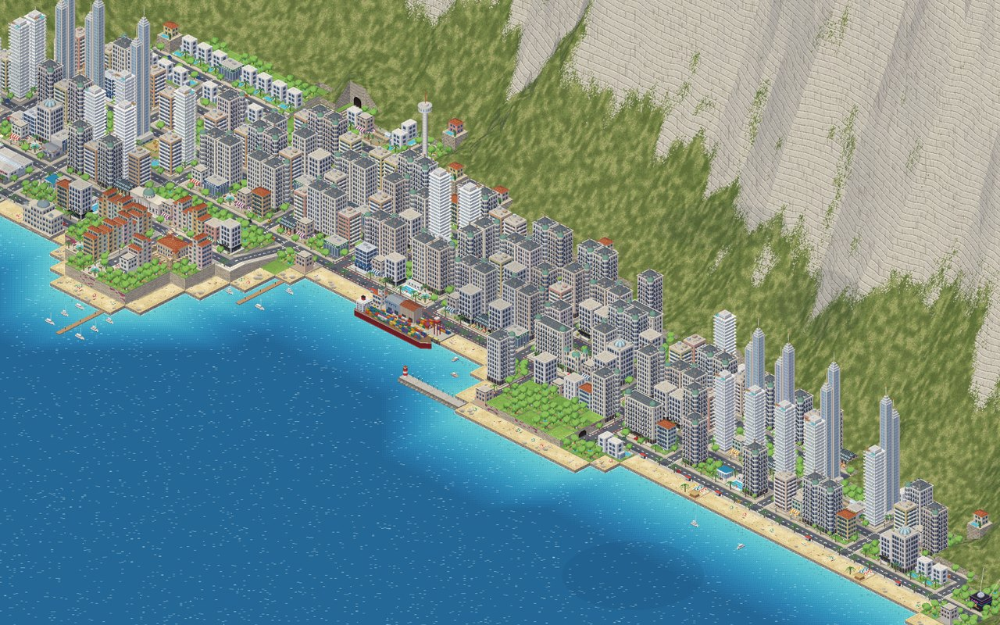

# Port Azur

An isometric pixel-art city builder for the browser. Build a harbour city on a Monaco-like coast, squeezed between a giant mountain and the sea. A ship docks every morning and pays for every resident the harbour can serve, so keep the books in the black and the residents happy.



- Housing, shops (groceries, clothes, utilities), leisure and landmarks, each with its own range
- Pick a colour for homes, shops and hotels when you build them, or repaint them later
- The Town paper: cash-reward jobs that pay more as the town grows, plus bank loans
- Supply trucks every morning, shops that sell out or close, protests and dock strikes
- Terrain you can raise and lower, ramps, road and rail tunnels and bridges
- Bus and train lines you plan yourself, plus intercity routes that bring in tourists
- Hotels, tourist centres and a Grand Prix street circuit every 20 days
- A fully built demo city to explore from the title screen

The whole game is plain HTML, CSS and JavaScript with no frameworks and no dependencies. A small build script bundles it into one self-contained page.

## Analytics

The page includes Vercel Web Analytics (two small script tags at the end of the `<head>` in `src/index.html`). It counts visitors and page views on the deployed site. To see the numbers:

1. In your Vercel project, open the **Analytics** tab and click **Enable** (if it isn't on yet).
2. Visit your site. Data appears in the Analytics tab within a minute or so.

Visitors with ad or content blockers aren't counted. When you run the game locally, the analytics script isn't found and nothing is tracked.

## Saves

On a normal website, saves live in each player's browser (`localStorage`): an autosave at the end of every game day plus three manual slots. When the page runs inside Claude as an artifact, the same saves also sync to the player's private cloud slot. That code switches itself off everywhere else.

## Project layout

```
src/
  index.html        page template (the build fills in the CSS and JS)
  style.css         all interface styles
  js/               the game, bundled in file-name order
    00_config.js      prices, buildings, levels, balance numbers
    01_util.js        helpers, noise, colours
    01b_demo.js       the built-in demo city (generated, see below)
    02_raster.js      the pixel-art 3D rasterizer
    03_map.js         coastline, mountain and the landscape around the map
    04_models.js      building models
    05_terrain.js     ground, water, terraces, tunnels and bridges
    06_state.js       game state, placing, terrain editing
    07_net.js         roads, rail, transit lines, the race circuit
    08_sim.js         economy, happiness, shops, tourism, events
    08b_paper.js      the Town paper: reward ads and jobs
    09_agents.js      cars, buses, trains, ships, people, the race
    10_render.js      drawing the city
    10b_backdrop.js   the mountains and sea beyond the map
    11_input.js       mouse, touch and keyboard tools
    11b_icons.js      pixel icons
    12_ui.js          HUD, build menus, info panels
    12b_menu.js       menu, saves, settings, title screen
    13_main.js        saving, loading and start-up
tools/
  serve.mjs         local web server for npm run preview
  demo/             rebuilds the demo city (optional)
docs/               screenshots for this README
build.mjs           bundles src/ into dist/index.html
vercel.json         Vercel build settings
```

To change prices or game balance, start in `src/js/00_config.js`, then run `npm run build` (or `npm run preview`) to see the result.

## Rebuilding the demo city (optional)

The demo city is a save file stored in `src/js/01b_demo.js`. It is generated by `tools/demo/build-demo-city.js`, which places every road, building and transit line using the game's own rules. To change it:

1. Install the browser automation tool once: `npm install --no-save playwright && npx playwright install chromium`.
2. Edit `tools/demo/build-demo-city.js`.
3. Run `npm run demo`. The script builds the city, lets it run for three game days, prints a health report (population, happiness, income, anything that failed to place) and writes a new `src/js/01b_demo.js`.

The game exposes a debug object, `window.__PA`, that this tool uses. It doesn't affect players.

## License

No license file is included yet, so by default all rights are reserved. Add a `LICENSE` file if you want to let others reuse the code.
